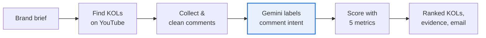
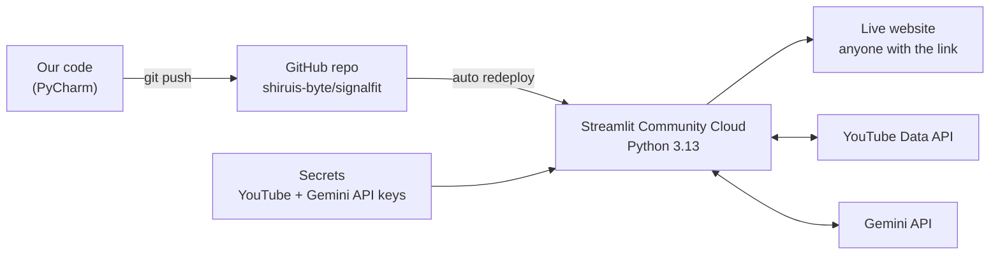

# 📡 SignalFit ✨

**SignalFit helps brands efficiently choose the right YouTube KOLs (creators) for their product, by analyzing what viewers say in the comments.**

A brand describes its product. SignalFit searches YouTube, reads each creator's comments with Gemini, and ranks creators by their audience's real needs, buying intent and trust, not by follower count.

| | |
| --- | --- |
| 🌐 **Live app** | https://signalfit-usc.streamlit.app |
| 🎓 **Course** | USC Annenberg, COMM 586 Advanced Applied AI, Group 2, Fall 2026 |
| 🚦 **Stage** | Final (near-final product: polish and fixes only, no new core features) |
| 🏆 **Headline result** | Gemini labels comments with Macro-F1 **0.58** vs **0.35** for keyword rules, on 174 comments our team labelled by hand |

## 🗺️ Contents

| # | Section | What you'll find |
| --- | --- | --- |
| 1 | [🎯 The problem](#1--the-problem) | Why follower counts are not enough, and who SignalFit is for |
| 2 | [✨ How SignalFit has changed](#2--how-signalfit-has-changed) | From Showcase to Final, and the feedback we acted on |
| 3 | [🔧 How it works](#3--how-it-works) | Architecture, the five metrics, and how it is deployed |
| 4 | [📱 Use it in five steps](#4--use-it-in-five-steps) | What a brand does on the site |
| 5 | [📊 Evaluation and results](#5--evaluation-and-results) | How we test, model results, error analysis, user testing |
| 6 | [🔁 How we iterated](#6--how-we-iterated) | What we changed and the challenges we solved |
| 7 | [🚧 Limitations and risks](#7--limitations-and-risks) | What SignalFit can't do yet |
| 8 | [💭 Reflection](#8--reflection) | What we learned and would do differently |
| 9 | [🔭 Future work](#9--future-work) | What we would build next |
| 10 | [🔒 Privacy and responsible use](#10--privacy-and-responsible-use) | What data we use and how |
| 11 | [💻 Code](#11--code) | Files, running it locally, team labelling |
| 12 | [📚 Tools and references](#12--tools-and-references) | APIs and libraries |

---

## 1. 🎯 The problem

> 💡 **In short:** followers show reach, comments show need.

Brands usually pick creators by follower count, but followers only show who will *see* a post, not who *needs* the product. A comment like "So pretty! 😍" comes from a fan; "Does this sting sensitive skin?" comes from a customer.

**Who it is for:** a brand marketer with a product and a budget who needs a creator shortlist they can defend to their manager.

---

## 2. ✨ How SignalFit has changed

> 💡 **In short:** from a Colab notebook with 21 hand-picked creators to a live website that searches all of YouTube and measures its own accuracy.

| | Showcase | Intermediate Demo | **Final** |
| --- | --- | --- | --- |
| **Product** | Colab notebook | Interactive website | **Same website, polished and stable** |
| **KOLs** | 21 hand-picked | All YouTube KOLs, searched live | All YouTube KOLs, searched live |
| **Categories** | Skincare only | + Running, Fitness nutrition, Tech | + Running, Fitness nutrition, Tech |
| **Metrics** | 4 | 5, adding audience loyalty | 5, adding audience loyalty |
| **Brand tools** | Ranking only | Shortlist, outreach email, evaluation | **+ creator's public business email, one click to send** |
| **Evaluation** | Planned | Labelling built into the app | **Done: 6 people, 174 comments, Macro-F1 0.58 vs 0.35, error analysis, user testing** |

> [!IMPORTANT]
> 💡 **Showcase feedback:** *"make the metrics more diverse"* → we added **Community** as our **fifth metric**, which measures audience loyalty.

| 💬 Data | 🤖 Model | 🚀 Deployment |
| --- | --- | --- |
| **Comments, not followers.** Followers show reach. Comments show real needs and buying intent. | **Gemini Flash-Lite.** No labelled data to train on, so a prompt with our own 8 labels. Fast, cheap, runs in parallel. | **Streamlit Cloud + GitHub.** Every push goes live. Anyone can use it: [signalfit-usc.streamlit.app](https://signalfit-usc.streamlit.app) |

More detail: [6. How we iterated](#6--how-we-iterated) · [5. Evaluation and results](#5--evaluation-and-results) · [7. Limitations and risks](#7--limitations-and-risks)

---

## 3. 🔧 How it works

> 💡 **In short:** six steps from a brand brief to a ranked shortlist; only one step uses AI.

### 3.1 🧩 Architecture

The blue step calls Gemini; every other step is our own Python code. Creators and comments are pulled live from YouTube for each new search.

### 3.2 📏 The five metrics

| Metric | What it asks | Weight (sales goal) |
| --- | --- | --- |
| 🎬 Content relevance | Does their content fit my product? | 25% |
| 🙋‍♀️ Audience need | Do their viewers have the problem my product solves? | 25% |
| 🛒 Purchase + trust | Are viewers ready to buy, and do they trust the creator? | 20% |
| 💬 Engagement quality | Are the comments real conversations, not spam? | 15% |
| 🫶 Community 🆕 | Are the viewers loyal and active? | 15% |

### 3.3 🚀 Deployment

SignalFit runs on **Streamlit Community Cloud**, deployed straight from this GitHub repository. We built the code with **Claude as our AI coding assistant**; we designed the problem, the 8 comment labels, the five metrics and their weights, and the evaluation ourselves.

| Step | What happens |
| --- | --- |
| 1. Code | The app is three Python files (`app.py`, `ui.py`, `engine.py`) plus `requirements.txt`. |
| 2. Push | Every `git push` to `main` on GitHub triggers Streamlit Cloud to rebuild and redeploy the site automatically, usually within 1–2 minutes. |
| 3. Keys | The YouTube and Gemini API keys are stored in Streamlit Cloud's **Secrets**, never in the code or the repo (`.streamlit/secrets.toml` is git-ignored). |
| 4. Use | Anyone with the link can sign in and run a live search; no installation needed. |
| 5. Where the data lives | Search data (creators, videos, comments) is pulled **live from YouTube** for every new search and only cached on the server. |
| 6. Data that must last | The server's disk is temporary and is wiped when the app restarts or sleeps after a period with no visitors. So everything that must last, such as the evaluation comment set and the team's label CSVs, is committed to GitHub under `label_sets/`. |

**Cost and scale:** hosting is free. One search uses about 390 of YouTube's 10,000 free daily quota units (about 25 searches a day) and about 12 Gemini Flash-Lite calls to label 480 comments. Repeat searches are served from cache. Real use would need a paid YouTube quota.

---

## 4. 📱 Use it in five steps

> 💡 **In short:** describe your product, click once, and get a shortlist with evidence and a ready-to-send email.

1. 👋 **Sign in** with your name, email and brand, and accept the privacy notice. First-time users get a short tour.
2. 📝 **Describe your product:** product, up to 3 search keywords, target audience, the problem your audience has, budget per creator, and goal (conversion or awareness). Or start from a template (Skincare, Running, Fitness nutrition, Tech).
3. 🔎 **Click Find creators.** SignalFit searches YouTube, reads the comments with Gemini and scores each creator. A new search takes about 1–2 minutes; a repeated one loads from cache.
4. 👀 **Read the results.** The top picks come first. Open "How was this score calculated?" to see the five sub-scores, switch the goal or budget under Adjust ranking, and open Creator details to see the real comments behind each reason.
5. 💌 **Act on it.** Add creators to your shortlist (the top 3 are added by default), compare them side by side, download the list as CSV, or draft an outreach email. If the creator lists a business email in their YouTube description, SignalFit shows it and opens the draft in your email app; if not, it links to the creator's YouTube contact page.

---

## 5. 📊 Evaluation and results

> 💡 **In short:** Gemini clearly beats keyword rules (0.58 vs 0.35) but is below our 0.75 target; users want to see who the audience is, whether comments are real, and why the metrics are weighted as they are.

### 5.1 🧪 How we test

- **Test set:** 175 real comments from one skincare search, saved permanently in `label_sets/skincare-cleanser/`. The set is fixed so that every teammate labels the same comments.
- **Human labels:** 6 teammates label inside the app (Label comments page) without seeing the AI's answer. Each comment can get any of the 8 labels, or none. 20 comments are labelled by everyone, to measure agreement; the rest are split between us. Where people overlap, the majority label counts.
- **Baseline:** simple keyword rules (`KEYWORD_RULES` in `engine.py`), e.g. "where can I buy" → wants to buy, a "?" → product question. If the AI cannot beat this, it is not worth its cost.
- **Grounding:** every comment ID an explanation cites must exist in the data, so evidence shown to a brand is never invented.
- **Where the numbers come from:** the Results tab of the Label comments page computes everything below from the saved labels (`evaluate_labels` and `team_agreement` in `engine.py`).

<b>What each metric measures</b> (click to expand)

| Metric | What it measures | How it is computed | How to read it |
| --- | --- | --- | --- |
| Precision (per label) | When the AI gives a comment a label, how often our team agrees | AI and humans both chose the label ÷ AI chose the label | Low precision = the AI over-uses the label |
| Recall (per label) | Of the comments our team gave a label, how many the AI also caught | AI and humans both chose the label ÷ humans chose the label | Low recall = the AI misses that kind of comment |
| F1 (per label) | One score for each label that balances precision and recall | 2 × precision × recall ÷ (precision + recall) | 0 = never right, 1 = matches the team exactly |
| Macro-F1 | The AI's overall labelling quality | The plain average of the 8 per-label F1 scores, so rare labels count as much as common ones | Our main number. Target: 0.75 |
| Keyword baseline Macro-F1 | How well a no-AI approach does on the same comments | The same Macro-F1, with keyword rules in place of Gemini | The AI's Macro-F1 should be clearly higher |
| Cohen's kappa | How much our teammates agree with each other, beyond chance | On the 20 shared comments, for each pair of teammates and each label, then averaged | 0.2–0.4 fair, 0.4–0.6 moderate, above 0.6 substantial |
| Search time | How long a brand waits for results | From clicking Find creators to the results page | Whether the tool fits a real workflow |
| Cost per search | What one search uses up | YouTube quota units out of 10,000 a day; Gemini calls | How many brands the free tier can serve |
| User feedback | Whether real people find it useful | Users outside the team try the site and tell us what helps and what doesn't | Whether the product solves the user's problem |

### 5.2 📈 Model results

All six teammates finished labelling: **174 of the 175 comments** have a human label.

| Measure | Result | Target / reading |
| --- | --- | --- |
| **Macro-F1, Gemini** | **0.58** | Target 0.75: not yet met |
| Macro-F1, keyword baseline | 0.35 | Gemini is clearly better ✓ |
| Team agreement (mean Cohen's kappa, 15 pairs) | 0.41 | Moderate: people disagree on some labels too |
| Comments where Gemini's labels exactly match ours | 82 of 174 (47%) | |
| Comments where Gemini gets at least one label right | 128 of 174 (74%) | |
| Label-level agreement (174 comments × 8 labels) | 1,255 of 1,392 (90%) | |
| Search time | about 1–2 min new, under 1 s repeated | Target ≤ 2 min ✓ |

**F1 per label** (sorted by Gemini's score):

| Label | Gemini F1 | Keyword F1 | Reading |
| --- | --- | --- | --- |
| Product question | **0.81** | 0.62 | Above target |
| Personal experience | **0.77** | 0.63 | Above target |
| Positive reaction | **0.76** | 0.45 | Above target |
| Price concern | 0.63 | 0.60 | Close to keywords: price words are easy to spot |
| Complaint | 0.56 | 0.23 | Gemini catches only 10 of the 21 complaints we marked |
| Creator trust | 0.41 | 0.27 | Gemini catches only 9 of the 30 we marked (recall 0.30) |
| Spam | 0.38 | 0.00 | Misses bot comments repeated across creators |
| Purchase intent | 0.31 | 0.00 | Only 6 human examples, so the score is unstable |

### 5.3 🔍 Error analysis: what goes wrong and why

1. **Our own labels are part of the problem.** Each teammate's labels, compared with Gemini on their own, give F1 anywhere from 0.38 to 0.72. Most comments were labelled by one person, so that person's habits decide what counts as "right". On the 20 comments everyone labelled (majority vote), Gemini's F1 is already 0.63.
2. **Gemini under-uses "creator trust".** We counted thank-yous for useful advice ("Dr Dray is the real deal!") as trust; Gemini mostly calls them positive reactions.
3. **Questions hidden in long stories are missed.** A comment that tells a long skin history and then asks "which face wash should I use?" is often labelled only as personal experience (15 extra experience labels overall).
4. **Bot comments look like praise.** "So true, this really resonates with me." appears word for word under 4 different creators. Gemini calls it a positive reaction, and so did some of us. A rule that flags identical text across creators fixes the ranking, but barely moves F1 (0.577 → 0.583), because our labels call these comments positive too.

### 5.4 🔦 Hallucination check (in-class Test B)

- **Does Gemini invent labels?** Some "misses" were Gemini being right: it marked a repeated book ad and a thumbnail-editing sales pitch as spam where some of us had labelled them trust or praise.
- **Does the app invent evidence?** No. Every reason shown to a brand must cite comment IDs from the data, and the code checks each ID before display.

### 5.5 🙋 User testing

Our numbers show how well the AI reads comments. To learn whether SignalFit actually helps the people it is for, we had users outside our team try the live site (describe a product, run a search, read the results, build a shortlist) and then talked with them about it. <!-- Add: how many people, and questionnaire scores if you have them -->

| What users said | What SignalFit does today | What we would change |
| --- | --- | --- |
| 👥 **"Is this creator's audience the one I want?"** A brand selling to people around 20 can find creators whose comments match the product, but can't see who the viewers are (age, gender, location). | Shows what viewers talk about and how well their needs match the brief. YouTube's public API does not share audience demographics. | Show more about who the audience is, e.g. from creators' media kits or analytics they choose to share. |
| 🤔 **"Are these comments real?"** Users weren't sure the comments were organic and not bots or paid. | Removes rule-based spam (links, "sub to my channel", emoji-only) and repeated comments within a creator, and scores engagement quality. | Flag comments repeated word for word across creators, and show each creator's share of spam and duplicates. |
| ⚖️ **"Why are the metrics weighted like this? I want to choose."** Users didn't understand the weights and wanted to set them themselves. | Two goal presets (conversion, awareness) and "How was this score calculated?" with the formula. | Explain each metric in plain words, and let brands set their own weights. |

💡 **What this changed for us:** users trust a ranking only when they can see *who* the audience is, believe the comments are *real*, and understand *why* the score is what it is. These three points shape our [future work](#9--future-work).

---

## 6. 🔁 How we iterated

> 💡 **In short:** every major change came from a problem we hit or feedback we got.

### 6.1 🛠️ What we changed

| What | Before | After | Why |
| --- | --- | --- | --- |
| Product | Colab notebook, 21 fixed creators | Deployed website, any product, live discovery | A brand must be able to use it without us |
| Comment labels | Keyword rules | Gemini with an 8-label codebook in the prompt | Keywords miss sarcasm and context |
| Model | Gemini 2.5 Flash (midterm) | Flash-lite models with automatic fallback | Faster, cheaper, keeps working when one model is busy |
| Content fit | MiniLM embeddings in Colab | Gemini rates titles, in parallel with labelling | No model download on the web server |
| Score | 4 sub-scores | 5, adding Community | Loyal, active audiences are more likely to buy |
| Budget | Filtered after scoring | Also caps creator size during discovery | Changing the budget used to leave results unchanged |
| Evaluation | Labelling planned in Colab | Labelling inside the app, split across 6 people | Teammates can label from any browser |
| Results | No numbers yet | Macro-F1 0.58 vs 0.35 baseline, kappa 0.41, error analysis | We need to know where the AI fails before tuning it |
| Prompt | Version 1 (8-label codebook) | **In progress:** versions tuned on the errors above, each scored | Fix the weakest labels first |
| Outreach | Email draft only | + the creator's public business email and a link to their contact page | A brand needs to know where to send the email |

### 6.2 🧗 Challenges we solved

**🐢 → ⚡ 1. Live search was too slow to demo.** The first live version read comments one batch at a time and Gemini often answered "busy"; a search took several minutes. We now run 6 labelling batches in parallel, rate relevance at the same time, write explanations only for the top 3 (others on demand), switch to a backup model when one is busy, and cache every API response. A search now takes about 1–2 minutes, and a repeated brief loads in under a second.

**🏷️ 2. Building an evaluation set we can trust.** One person's labels are not ground truth, and the hosted app's disk is wiped on every restart. We built labelling into the app: a fixed comment set stored in GitHub, blind labelling, 20 shared comments to measure agreement (kappa), majority vote where people overlap, and label CSVs that are committed to the repo so the results survive restarts.

**🪞 3. Finding out that "wrong" was sometimes us.** Our first full result (0.58) was below target. Instead of only rewriting the prompt, we checked the labels themselves: teammates disagree with each other (kappa 0.41), each person's labels match Gemini to a very different degree, and some of Gemini's "errors" were correct spam calls. So our plan fixes the labels first, then the prompt, and tests on comments the prompt has never seen.

---

## 7. 🚧 Limitations and risks

> 💡 **In short:** SignalFit suggests, the marketer decides.

| Limitation | Why it matters | What we do about it |
| --- | --- | --- |
| Labelling accuracy is below target (0.58 vs 0.75) | Rankings for trust- and purchase-driven creators may be off | SignalFit suggests and the marketer decides; every reason shows the real comments behind it |
| People disagree on what a comment means (kappa 0.41) | The "right answer" we grade against is uncertain | Agree on label rules as a team, double-label comments |
| All test comments come from one skincare search | The score may not hold for running or tech | Test the final prompt on a new category |
| Purchase comments are rare (6 in 174) | "Wants to buy" can't be measured reliably | Label more comments across categories |
| No audience demographics | Brands can't check age or location of viewers | Show audience data creators choose to share |
| Bot comments repeated across creators count as praise | Inflates some creators' engagement | Flag identical text across creators as spam |
| Comments stand in for sales | YouTube does not publish sales or watch-through rates | State it clearly to users |
| Costs are estimated from subscriber counts | Not real creator rates | Label it as an estimate in the app |
| English only; about 25 searches a day on the free quota | Limits real use | Apply for a higher YouTube quota if the project continues |

---

## 8. 💭 Reflection

> 💡 **In short:** a low score taught us as much about our labels and our users as about the AI.

### 8.1 🌟 Lessons learned

1. **A low score is not always the AI's fault.** Gemini scored 0.58, below our 0.75 target, but our own team only agreed moderately (kappa 0.41).
2. **Some of Gemini's "errors" were actually right.** It marked a repeated book ad as spam, while some of us had labelled it as praise.
3. **Users need more than a ranking.** In user testing, people wanted to know whether a creator's audience fits their target, whether the comments are real, and why the metrics are weighted the way they are.
4. **AI should support the decision, not make it.** Every reason in SignalFit shows the real comments behind it, and the marketer makes the final call.
5. **A good model is not enough if it's too slow.** Our first live search took several minutes; with parallel calls, backup models and caching it now takes one to two minutes.
6. **One person's labels are not ground truth.** We built labelling into the app, with a fixed comment set, blind labelling and shared comments, so we could trust our results.
7. **A brand must be able to use the tool without us.** That's why we moved from a Colab notebook to a live website.

### 8.2 🔄 What we'd do differently

- Test with real users much earlier, not only with our own labels.
- Agree on our label rules as a team before labelling, and have more comments labelled by two people.
- Build the test set from several categories, not just one skincare search.
- Collect more purchase comments: we only had 6 out of 174.
- Start evaluating earlier. At the Showcase, our evaluation was still only a plan.

---

## 9. 🔭 Future work

> 💡 **In short:** improve accuracy honestly, and answer the three questions users asked.

| Next step | Why |
| --- | --- |
| 🎯 Tune the prompt on the errors we found, and test it on comments it has never seen, including a new category | Reach the 0.75 target without overfitting to our test set |
| 🤖 Flag bot comments that repeat word for word across creators as spam | Users weren't sure the comments were real |
| 👥 Show more about who the audience is | Users want to check that it matches their target |
| ⚖️ Explain each metric in simple words, and let brands set their own weights | Users didn't understand the weights and wanted to choose |
| 🏷️ Label more comments across more categories | To measure purchase intent reliably |
| 📈 Apply for a higher YouTube quota | The free quota allows only about 25 searches a day |

---

## 10. 🔒 Privacy and responsible use

- Only public YouTube data, through the official YouTube Data API.
- Sign-in details (name, email, brand) stay in the browser session; users must accept a privacy notice before entering.
- Comments are sent to Gemini for labelling. Searches and results are cached on the server.
- Explanations may only cite real comment IDs, checked before they are shown.
- Creator emails are shown only when the creator published them in their own YouTube descriptions.

---

## 11. 💻 Code

| File | What it holds |
| --- | --- |
| `app.py` | The screens: sign-in, tour, search, results and its tabs, Label comments, How scoring works |
| `ui.py` | The look and shared pieces: colours, stylesheet, avatars, quotes, session state, the outreach email box |
| `engine.py` | Everything behind the screens, no Streamlit code: YouTube and Gemini clients, scoring, the live search, evaluation (F1, kappa) |
| `label_sets/<name>/` | Permanent comment sets for team labelling (`comments.csv`, `set.json`) and each teammate's finished labels in `labels/*.csv` |
| `requirements.txt`, `.streamlit/config.toml` | Dependencies and theme |

### 11.1 🏃 Run it locally

    python -m venv .venv && source .venv/bin/activate
    pip install -r requirements.txt
    streamlit run app.py

Keys go in `.streamlit/secrets.toml` (never committed; it is in `.gitignore`), or in Streamlit Cloud under App settings → Secrets:

    YOUTUBE_API_KEY = "..."
    GEMINI_API_KEY = "..."
    ACCESS_CODE = "..."   # optional: visitors need this code to enter

Live search sizes (creators, videos, comments, parallel calls) are in `LIVE` near the top of `engine.py`.

### 11.2 🤝 Team labelling

1. On your own computer, run a search, open **Label comments**, and use **Make this a permanent team set**. Commit and push the new `label_sets/` folder.
2. Teammates open the live app → Label comments → the Team set, enter the number of people and their own number, and label their share.
3. Each teammate downloads their CSV from the Results tab. Put the CSVs in `label_sets/<name>/labels/` and push: the Results tab then shows the team's numbers permanently.

---

## 12. 📚 Tools and references

- [YouTube Data API v3](https://developers.google.com/youtube/v3)
- [Gemini API](https://ai.google.dev/)
- [Streamlit](https://streamlit.io/) and Streamlit Community Cloud
- pandas, NumPy, Altair, Requests

---

Made with 💜 by Group 2 · USC Annenberg · Fall 2026 🌴

