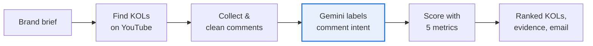
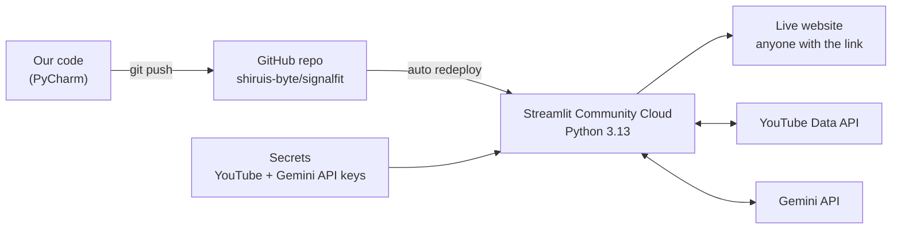

# SignalFit

**SignalFit helps brands efficiently choose the right YouTube KOLs (creators) for their product, by analyzing what viewers say in the comments.**

A brand describes its product. SignalFit searches YouTube, reads each creator's comments with Gemini, and ranks creators by their audience's real needs, buying intent and trust, not by follower count.

| | |
| --- | --- |
| **Live app** | https://signalfit-usc.streamlit.app |
| **Course** | USC Annenberg, COMM 586 Advanced Applied AI, Group 2, Fall 2026 |

## The problem

Brands usually pick creators by follower count, but followers only show who will *see* a post, not who *needs* the product. A comment like "So pretty! 😍" comes from a fan; "Does this sting sensitive skin?" comes from a customer.

**Who it is for:** a brand marketer with a product and a budget who needs a creator shortlist they can defend to their manager.

---

## ✨ What's new since the Showcase

We connect YouTube and Gemini to help brands find the right KOLs efficiently, by analysing viewers' comments.

| | At the Showcase | **Now** |
| --- | --- | --- |
| **Product** | Colab notebook | **Interactive website** |
| **KOLs** | 21 hand-picked | **All YouTube KOLs, searched live** |
| **Categories** | Skincare only | **+ Running, Fitness nutrition, Tech** |
| **Metrics** | 4 | **5, adding audience loyalty** |
| **Brand tools** | Ranking only | **Shortlist, outreach email, evaluation** |

> [!IMPORTANT]
> **Showcase feedback:** *"make the metrics more diverse"* → we added **Community** as our **fifth metric**, which measures audience loyalty.

| Data | Model | Deployment |
| --- | --- | --- |
| **Comments, not followers.** Followers show reach. Comments show real needs and buying intent. | **Gemini Flash-Lite.** No labelled data to train on, so a prompt with our own 8 labels. Fast, cheap, runs in parallel. | **Streamlit Cloud + GitHub.** Every push goes live. Anyone can use it: [signalfit-usc.streamlit.app](https://signalfit-usc.streamlit.app) |

More detail on every change: [How we iterated](#how-we-iterated) and [Challenges we solved](#challenges-we-solved).

---

## 🏗️ How it works (architecture)

The blue step calls Gemini; every other step is our own Python code. Creators and comments are pulled live from YouTube for each new search.

| Metric | What it asks | Weight (sales goal) |
| --- | --- | --- |
| Content relevance | Does their content fit my product? | 25% |
| Audience need | Do their viewers have the problem my product solves? | 25% |
| Purchase + trust | Are viewers ready to buy, and do they trust the creator? | 20% |
| Engagement quality | Are the comments real conversations, not spam? | 15% |
| Community 🆕 | Are the viewers loyal and active? | 15% |

---

## 🚀 How it's deployed

SignalFit runs on **Streamlit Community Cloud**, deployed straight from this GitHub repository: https://signalfit-usc.streamlit.app

We built the code with **Claude as our AI coding assistant**; we designed the problem, the 8 comment labels, the five metrics and their weights, and the evaluation ourselves.

| Step | What happens |
| --- | --- |
| 1. Code | The app is three Python files (`app.py`, `ui.py`, `engine.py`) plus `requirements.txt`. |
| 2. Push | Every `git push` to `main` on GitHub triggers Streamlit Cloud to rebuild and redeploy the site automatically, usually within 1–2 minutes. |
| 3. Keys | The YouTube and Gemini API keys are stored in Streamlit Cloud's **Secrets**, never in the code or the repo (`.streamlit/secrets.toml` is git-ignored). |
| 4. Use | Anyone with the link can sign in and run a live search; no installation needed. |
| 5. Where the data lives | Search data (creators, videos, comments) is pulled **live from YouTube** for every new search and only cached on the server. |
| 6. Data that must last | The server's disk is temporary and is wiped when the app restarts or sleeps after a period with no visitors. So everything that must last, such as the evaluation comment set and the team's label CSVs, is committed to GitHub under `label_sets/`; searches are cached on the server only to speed up repeats. |

**Cost:** the hosting is free. Each search uses about 400 of YouTube's 10,000 free daily quota units (about 25 searches a day), and Gemini Flash-Lite is the cheapest model tier. Real use would need a paid YouTube quota.

---

## Use it in five steps

1. **Sign in** with your name, email and brand, and accept the privacy notice. First-time users get a short tour.
2. **Describe your product:** product, up to 3 search keywords, target audience, the problem your audience has, budget per creator, and goal (conversion or awareness). Or start from a template (Skincare, Running, Fitness nutrition, Tech).
3. **Click Find creators.** SignalFit searches YouTube, reads the comments with Gemini and scores each creator. A new search takes about 1–2 minutes; a repeated one loads from cache.
4. **Read the results.** The top picks come first. Open "How was this score calculated?" to see the five sub-scores, switch the goal or budget under Adjust ranking, and open Creator details to see the real comments behind each reason.
5. **Act on it.** Add creators to your shortlist (the top 3 are added by default), compare them side by side, download the list as CSV, or draft an outreach email.

---

## Evaluation

We grade Gemini's comment labels against our own human labels, and compare it with a simple keyword baseline.

### How we test

- **Test set:** 175 real comments from one skincare search, saved permanently in `label_sets/skincare-cleanser/`. The set is fixed so that every teammate labels the same comments.
- **Human labels:** 6 teammates label inside the app (Label comments page) without seeing the AI's answer. Each comment can get any of the 8 labels, or none. 20 comments are labelled by everyone, to measure agreement; the rest are split between us. Where people overlap, the majority label counts.
- **Baseline:** simple keyword rules (`KEYWORD_RULES` in `engine.py`), e.g. "where can I buy" → wants to buy, a "?" → product question. If the AI cannot beat this, it is not worth its cost.
- **Where the numbers come from:** the Results tab of the Label comments page computes everything below from the saved labels (`evaluate_labels` and `team_agreement` in `engine.py`).

### What each metric measures

| Metric | What it measures | How it is computed | How to read it |
| --- | --- | --- | --- |
| Precision (per label) | When the AI gives a comment a label, how often our team agrees | AI and humans both chose the label ÷ AI chose the label | Low precision = the AI over-uses the label |
| Recall (per label) | Of the comments our team gave a label, how many the AI also caught | AI and humans both chose the label ÷ humans chose the label | Low recall = the AI misses that kind of comment |
| F1 (per label) | One score for each label that balances precision and recall | 2 × precision × recall ÷ (precision + recall) | 0 = never right, 1 = matches the team exactly; shows which intents the AI reads well or badly |
| Macro-F1 | The AI's overall labelling quality | The plain average of the 8 per-label F1 scores, so rare labels (wants to buy) count as much as common ones (product question). Labels that nobody used are left out | Our main number. Target: 0.75 |
| Keyword baseline Macro-F1 | How well a no-AI approach does on the same comments | The same Macro-F1, with the keyword rules in place of Gemini | The AI's Macro-F1 should be clearly higher |
| Cohen's kappa | How much our teammates agree with each other, beyond what chance would give | On the 20 shared comments, for each pair of teammates and each label: (observed agreement − chance agreement) ÷ (1 − chance agreement); then averaged | 0 = no better than chance, 0.2–0.4 fair, 0.4–0.6 moderate, above 0.6 substantial. It caps how high the AI can reasonably score: if people disagree, the "right answer" is uncertain |
| Search time (latency) | How long a brand waits for results | Time from clicking Find creators to the results page, for new briefs and for repeated ones | Whether the tool is usable in a real workflow |
| Cost per search | What one search uses up | YouTube API quota units per search (search, channels, videos, comments calls) out of 10,000 free per day; number of Gemini calls | How many brands the free tier can serve, and what scaling would cost |
| User feedback | Whether real people find it useful | Classmates outside the team try the site and rate ease of use and how sensible the picks are, each 1–5 | Whether the product solves the user's problem, not just the AI's |

Inside each search the app also checks **grounding**: every comment ID an explanation cites must exist in the data, so evidence shown to a brand is never invented.

### Results

To be added once all six teammates have finished labelling.

**Cost and scale:** one search uses about 400 of YouTube's 10,000 free daily quota units (about 25 searches a day). Gemini reads at most 40 comments per creator with the cheapest flash-lite model. Repeat searches are served from cache.

---

## How we iterated

| What | Before | After | Why |
| --- | --- | --- | --- |
| Comment labels | Keyword rules | Gemini with an 8-label codebook in the prompt | Keywords miss sarcasm and context |
| Model | Gemini 2.5 Flash (midterm) | Flash-lite models with automatic fallback | Faster, cheaper, keeps working when one model is busy |
| Content fit | MiniLM embeddings in Colab | Gemini rates titles, in parallel with labelling | No model download on the web server |
| Score | 4 sub-scores | 5, adding Community | Loyal, active audiences are more likely to buy |
| Budget | Filtered after scoring | Also caps creator size during discovery | Changing the budget used to leave results unchanged |
| Product | Colab notebook, 21 fixed creators | Deployed website, any product, live discovery | A brand must be able to use it without us |
| Evaluation | Labelling planned in Colab | Labelling inside the app, split across 6 people | Teammates can label from any browser |

### Challenges we solved

**1. Live search was too slow to demo.** The first live version read comments one batch at a time and Gemini often answered "busy"; a search took several minutes. We now run 6 labelling batches in parallel, rate relevance at the same time, write explanations only for the top 3 (others on demand), switch to a backup model when one is busy, and cache every API response. A search now takes about 1–2 minutes, and a repeated brief loads in under a second.

**2. Building an evaluation set we can trust.** One person's labels are not ground truth, and the hosted app's disk is wiped on every restart. We built labelling into the app: a fixed comment set stored in GitHub, blind labelling, 20 shared comments to measure agreement (kappa), majority vote where people overlap, and label CSVs that are committed to the repo so the results survive restarts.

---

## Limitations

- **People disagree on what a comment means,** so the human labels we grade against are themselves uncertain (see Cohen's kappa). Next: a tighter label guide, then tune the prompt on the errors and test on fresh comments, not the same ones.
- **Purchase comments are rare,** so "wants to buy" is hard to measure. Next: label more comments across more categories.
- **Comments stand in for sales.** YouTube does not publish sales or watch-through rates.
- **Costs are estimated** from subscriber counts, not real creator rates.
- **English only,** and the free API quota allows about 25 searches a day.

## Privacy and responsible use

- Only public YouTube data, through the official YouTube Data API.
- Sign-in details (name, email, brand) stay in the browser session; users must accept a privacy notice before entering.
- Comments are sent to Gemini for labelling. Searches and results are cached on the server.
- Explanations may only cite real comment IDs, checked before they are shown.

---

## Code

| File | What it holds |
| --- | --- |
| `app.py` | The screens: sign-in, tour, search, results and its tabs, Label comments, How scoring works |
| `ui.py` | The look and shared pieces: colours, stylesheet, avatars, quotes, session state, the outreach email box |
| `engine.py` | Everything behind the screens, no Streamlit code: YouTube and Gemini clients, scoring, the live search, evaluation (F1, kappa) |
| `label_sets/<name>/` | Permanent comment sets for team labelling (`comments.csv`, `set.json`) and each teammate's finished labels in `labels/*.csv` |
| `requirements.txt`, `.streamlit/config.toml` | Dependencies and theme |

### Run it locally

    python -m venv .venv && source .venv/bin/activate
    pip install -r requirements.txt
    streamlit run app.py

Keys go in `.streamlit/secrets.toml` (never committed; it is in `.gitignore`), or in Streamlit Cloud under App settings → Secrets:

    YOUTUBE_API_KEY = "..."
    GEMINI_API_KEY = "..."
    ACCESS_CODE = "..."   # optional: visitors need this code to enter

Live search sizes (creators, videos, comments, parallel calls) are in `LIVE` near the top of `engine.py`.

### Team labelling

1. On your own computer, run a search, open **Label comments**, and use **Make this a permanent team set**. Commit and push the new `label_sets/` folder.
2. Teammates open the live app → Label comments → the Team set, enter the number of people and their own number, and label their share.
3. Each teammate downloads their CSV from the Results tab. Put the CSVs in `label_sets/<name>/labels/` and push: the Results tab then shows the team's numbers permanently.

## Tools and references

- [YouTube Data API v3](https://developers.google.com/youtube/v3)
- [Gemini API](https://ai.google.dev/)
- [Streamlit](https://streamlit.io/) and Streamlit Community Cloud
- pandas, NumPy, Altair, Requests
